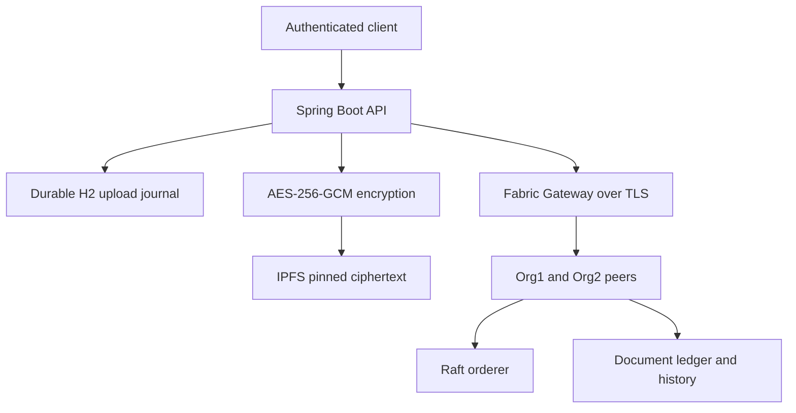

# Architecture

## Source map

| Location | Responsibility |
|---|---|
| `application/api-spring` | Java API, validation, authentication, crypto, storage coordination and tests |
| `chaincode/docregistry` | Authoritative document rules, issuing identity, revocation and history |
| `fabric-samples` | Upstream submodule at a fixed commit; not modified by setup |
| `scripts` | Isolated development bootstrap, enrollment, tests and source hygiene |
| `config/images.json` | Immutable development image references |
| `docker-compose.yml` | API and persistent IPFS; attaches to the separately created Fabric network |
| `.runtime` (ignored) | Generated network, identities, keys, logs, tools and journal |

Root Express entry points are retired because they referenced incompatible contracts and insecure wallet conventions. The small `application/client` example uses the authenticated HTTP API. Generated dependencies, build output, uploaded files and wallets are no longer tracked.

## Registration and recovery

1. Authenticate the caller and require `ISSUER`. Validate inputs and configured issuer.
2. Read at most 10 MiB, inspect a supported file signature, hash the exact plaintext bytes.
3. Build metadata with an opaque subject reference, document type, media type, registration UUID and encryption key ID. Original filenames are not stored.
4. Encrypt with a fresh 96-bit nonce and AES-256-GCM. Bind the envelope to `docId` as authenticated additional data. Persist ciphertext and intended registration in H2 before calling IPFS.
5. Query Fabric first. An existing record must match the journal registration UUID, digest, issuer, subject and metadata to confirm an uncertain attempt. A different registration is a conflict.
6. Add and pin ciphertext to IPFS. Persist its CID before submitting to Fabric. Retry uses the same encrypted envelope and therefore the same content identity.
7. Submit the contract transaction. On confirmed success, retain the journal outcome and clear its ciphertext copy. On uncertain dependency failure, return HTTP 202 and reconcile after restart or periodically. Never treat a timeout as proof that a commit failed.

This is a recoverable workflow, not a distributed atomic transaction. The single-instance implementation serializes uploads/reconciliation and uses a file-backed H2 journal. Multiple API writers require a shared database, leases, transactional capacity limits and tested concurrency changes. Failed/uncertain pins are deliberately retained until reviewed; an automated unpin could remove data whose Fabric commit succeeded.

## Ledger and identity

Schema version 2 preserves original document fields and adds `issuerMspId`, `registeredBy`, `registrationTxId`, and revocation actor/transaction fields. Timestamps derive from the signed transaction timestamp, not a nondeterministic wall clock. Metadata keys are serialized deterministically. IDs are 3–50 uppercase letters/digits/hyphens; hashes are `sha256:` plus 64 lowercase hexadecimal digits.

Registration requires X.509 attributes `registry.role=issuer` and `registry.department=<department>`. The issuer argument must match the certificate department. Revocation requires the same department and MSP as registration; repeats preserve the first reason and timestamp. API roles cannot bypass these rules. Direct channel readers can query chaincode subject to Fabric channel policies; REST roles do not restrict other Fabric members.

The development channel is `govchannel`; contract is `docregistry`. The two-organization sample uses the application `MAJORITY Endorsement` policy, requiring both organizations in this topology. CA-generated identities are fresh. There is one orderer, so this is not a fault-tolerant production topology.

## Verification and retrieval

Hash verification checks a supplied digest. File verification computes the digest from uploaded bytes. Both return `matches`, `revoked`, `valid` and a status. `valid = matches && !revoked`; missing IDs return 404 and dependency errors never become a positive result.

Download checks revocation, fetches bounded ciphertext, verifies the authenticated envelope, decrypts and compares the plaintext digest with the ledger. It returns an attachment with `Cache-Control: no-store`. Legacy plaintext IPFS references are not automatically downloaded. History returns at most the first 100 events and marks truncation; a full ledger export is required beyond that bound.

## Privacy boundaries

Document bytes are encrypted before leaving the API. Ledger metadata, hashes, issuer identities, transaction IDs and subject references remain visible to channel members. Do not put personal details, filenames or confidential revocation explanations into these immutable fields. The display subject is a reference, not proof of ownership. Citizen authorization uses a separate issuer-assigned hash of the OIDC issuer and immutable subject. Loss of all copies of an encryption key makes its documents unrecoverable.
