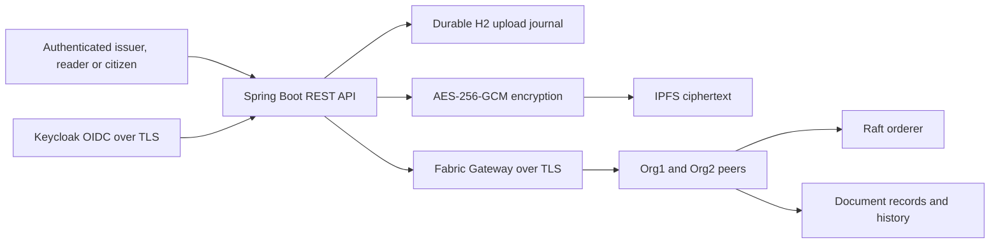

# Blockchain-Based Government Document Registry and Verification System

**Report draft for submission — October 14, 2026**

**Student name:** [Student name]

**USN:** 1DS23IC049

**College:** Dayananda Sagar College of Engineering

**Department:** CSE–IoT

**Guide:** [Guide name]

**Repository:** https://github.com/Sumanhm18/blockchain-govdoc

## Abstract

This project implements a permissioned document registry that combines Hyperledger Fabric, encrypted IPFS storage and a Spring Boot REST API. An authorized issuer registers a document's SHA-256 digest and limited metadata on the ledger while storing AES-256-GCM encrypted bytes off-chain. Authorized readers can retrieve documents, compare submitted files with their registered digests and check revocation. Department access and citizen ownership are enforced at the API; certificate attributes and MSP membership restrict chaincode mutations. A durable journal reconciles operations when storage or blockchain dependencies fail. Local tests demonstrate registration, tamper detection, revocation, access control and selected recovery scenarios. The result is a development prototype; it is not a production-certified government service or a claim of a novel blockchain primitive.

## 1. Problem and objectives

Document forgery, manual verification and fragmented department systems motivate a registry with consistent integrity checking and traceable lifecycle events. The objectives are to register authorized issuances, store documents outside the ledger, verify actual file bytes, preserve revocation history, protect stored contents and recover safely from dependency failures.

The project does not determine whether an officer's original claims are true. Identity proofing, legal validity and issuer governance remain organizational responsibilities. Blockchain protects recorded history within its trust model; it does not remove the need to trust authorized issuers.

## 2. Architecture and technologies

| Component | Implemented purpose |
|---|---|
| Same-origin HTML/CSS/JavaScript interface | Account/token entry, issuance, retrieval, file verification, revocation and history |
| Java 17 / Spring Boot 4.1.1 | REST endpoints, validation, authorization and workflow coordination |
| Fabric 2.5.16 / CA 1.5.22 | Permissioned ledger, membership, endorsement and certificate management |
| JavaScript contract / Node 22 | Deterministic registration, verification, revocation and history rules |
| IPFS Kubo 0.43.1 | Content-addressed storage of encrypted files |
| SHA-256 / AES-256-GCM | Plaintext integrity digest / authenticated encryption |
| H2 | Single-writer durable upload journal |
| Keycloak 26.8.0 / PostgreSQL 17 | Synthetic HTTPS/OIDC staging identity environment |
| Docker Compose | Reproducible isolated local services |

Exact image digests are committed in `config/`; runtime image IDs are checked against running services. The sample topology has two organizations, one peer each and one orderer. Under its endorsement policy both organizations are required for writes. This topology is not highly available.

## 3. Data model and lifecycle

A record contains its document ID, issuing department/MSP, plaintext digest, limited subject reference, metadata, transaction identifiers, timestamps and revocation state. Encrypted uploads include an IPFS CID and encryption envelope metadata. Personal details and original filenames should not be placed in immutable ledger metadata.

1. Authenticate an issuer and validate document ID, supported signature and size (up to 10 MiB).
2. Hash the exact input bytes. Encrypt with a fresh 96-bit nonce, binding the document ID as authenticated additional data.
3. Persist the intended registration and ciphertext before making external calls.
4. Query the ledger to reconcile any prior uncertain registration. Add and pin ciphertext in IPFS, then submit to Fabric.
5. Confirm the transaction and retain the journal outcome. A pending dependency operation returns HTTP 202 and is retried; a timeout is not interpreted as proof of non-commit.
6. For retrieval, enforce access, check revocation, fetch ciphertext, authenticate/decrypt it and compare the recovered plaintext digest with the ledger.
7. For verification, hash uploaded file bytes and return VALID, TAMPERED_OR_MISMATCH or REVOKED. Missing/inaccessible records return 404; dependency failures cannot produce VALID.
8. Restrict revocation to the authorized issuer department/MSP and preserve both lifecycle events in history.

The supplied-hash endpoint checks a caller-provided digest. The file-verification endpoint calculates the digest itself. An IPFS CID is a content reference to ciphertext and must not be equated with the plaintext SHA-256 digest.

## 4. Access control and privacy

Development uses generated Basic-auth accounts; TLS/OIDC staging validates token signature, issuer, audience, expiry and department. Issuers register/revoke. Readers access records issued by their configured department/MSP. Citizens access only records assigned to their validated OIDC issuer/subject hash; they cannot issue, revoke or view transaction history. Operators access protected metrics.

Chaincode independently checks issuer certificate attributes and department/MSP authority for mutations. The API uses a department service identity, so this design does not assign an individual Fabric certificate to every citizen. Other authorized channel members retain their Fabric-level read rights; REST access controls do not hide ledger metadata from them.

AES-GCM protects document bytes before IPFS receives them. It does not hide ledger metadata, remove previously downloaded copies or eliminate the need for key backups. File-signature validation is not malware detection. Generated credentials, private keys, journals and detailed operational logs remain outside source control.

## 5. Reliability and security engineering

The upload journal implements query-first reconciliation across separate IPFS and Fabric operations. It is a recovery mechanism, not a distributed atomic transaction. Tests cover IPFS outage, API restart, duplicate prevention and a simulated uncertain commit. A missing required endorser prevents writes until restored.

Runtime upgrades, non-root containers and removal of unnecessary vulnerable privilege-switching helpers reduce the attack surface. A full release gate scans source and runtime images and blocks high, critical, unknown and incomplete results. Findings are not silently suppressed. See `docs/SECURITY_GATE.md` for dated counts; the submission must retain remaining findings rather than imply all production security issues are solved.

The staging identity database was logically migrated into a separate PostgreSQL 17 volume using an encrypted backup. Identity/client/credential fingerprints and real OIDC checks verified the result; the original volume remains available. Application/IPFS backup testing checks authenticated encryption, tamper rejection, checksums and exact document recovery. A Fabric cold snapshot was created, but a complete Fabric ledger restore has not been proven.

## 6. Evaluation

Measured locally on macOS arm64 with Docker and synthetic data; see `TESTING_SUMMARY.md` for the dated validation record.

| Check | Observed result |
|---|---|
| Java tests | 44 pass |
| Chaincode tests | 17 pass |
| Live API/Fabric/IPFS integration | 16 checks pass |
| Direct Fabric authorization | 2 checks pass |
| HTTPS/OIDC ownership and roles | 37 checks pass, including 20 read-smoke requests |
| Presentation walkthrough | 14 checks against the real local stack |
| Restart, endorser and disposable-identity revocation drills | Pass |
| Encrypted application/IPFS restore | Pass |
| Full source/runtime security scans | Complete; residual findings still block release |
| Hosted CI | Jobs cannot start because of the account billing lock |

Tests demonstrate the checked behaviors and failure cases. They do not establish production throughput, penetration-test coverage, malicious-file detection, legal compliance or fault tolerance. No large-scale performance claims are made.

## 7. Limitations and future work

Resolve remaining dependency findings, rotate externally exposed historical credentials where applicable and complete old clone/cache cleanup. Provision real citizen proofing and account recovery, trusted production login domains, managed keys, monitored infrastructure and separately controlled off-site backups. Add resilient storage and ordering/peer topology, prove complete ledger disaster recovery and test production workload targets. Multi-instance API operation requires a shared journal with tested coordination. DID/verifiable credentials and selective disclosure remain future enhancements. The browser interface includes access-controlled paginated search, recently opened records, a history timeline and QR record links that require authentication. Local HTTPS staging supports authorization-code/PKCE citizen login through Keycloak. Real identity proofing and trusted production domains remain external deployment work.

## 8. Contribution

The implemented contribution is the integration and validation of a government-oriented document lifecycle with permissioned issuance, encrypted off-chain storage, revocation-aware file verification, department/citizen access and recoverable operations. The evaluation supports a working local prototype and makes its remaining deployment limits explicit.

## References and implementation evidence

- [Hyperledger Fabric documentation](https://hyperledger-fabric.readthedocs.io/) — membership, endorsement and ledger architecture.
- [IPFS documentation](https://docs.ipfs.tech/) — content addressing and storage behavior.
- [Spring Boot documentation](https://docs.spring.io/spring-boot/) — backend application framework.
- [Keycloak server guides](https://www.keycloak.org/guides#server) — identity runtime configuration.
- Repository: `docs/ARCHITECTURE.md`, `docs/API.md`, `docs/SECURITY.md`, `docs/OPERATIONS.md`, `docs/SECURITY_GATE.md`, `TESTING_SUMMARY.md` and `docs/SUBMISSION.md`.

These technologies predate this project. The report does not claim that combining blockchain and IPFS is an original research invention.
